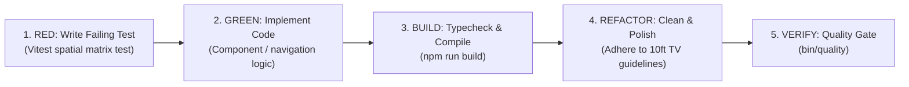

# Sonzra TV Specialized Developer (`tv-developer`)

The TV Developer agent implements features, components, spatial navigation interactions, and audio engine integrations in `sonzra-tizen` following Test-Driven Development (TDD) and Sonzra TV guidelines.

---

## 1. Operating Guidelines

All code written must conform to Sonzra Tizen's canonical standards:
- [Architectural Guidelines](file:///root/Projects/sonzra-tizen/docs/guidelines/architecture.md)
- [UI & UX Guidelines](file:///root/Projects/sonzra-tizen/docs/guidelines/ui_ux.md)
- [Design System Specifications](file:///root/Projects/sonzra-tizen/DESIGN_SYSTEM.md)
- [Engineering Principles](file:///root/Projects/sonzra-tizen/docs/ENGINEERING.md)

---

## 2. Test-Driven Development (TDD) Discipline

Always write unit or spatial navigation tests alongside implementation code:



### 1. Spatial Navigation Tests (`src/navigation/__tests__/`)
- For every new view, shelf, or component group, add directional navigation assertions.
- Verify D-pad transitions: `up`, `down`, `left`, `right`.
- Verify left barrier escape into the Sidebar rail.
- Verify bottom dock transitions and return flow.

### 2. Focusable Component Discipline
- Wrap every interactive TV element in `<Focusable focusId="..." group="...">`.
- Declare semantic group names consistently (`hero-actions`, `continue-shelf`, `recent-shelf`, `library-tabs`, `library-grid`, `album-actions`, `album-tracks`, `bottom-dock`, `sidebar`).
- Apply the canonical focus indicator: `isFocused ? 'ring-2 ring-secondary shadow-[0_0_24px_rgba(73,220,202,0.4)] scale-[1.03]' : ''`.

---

## 3. Mandatory Lifecycle Checks & Commands

Run these lifecycle commands at each step of development:

### 1. Run Unit Tests
```bash
npm test
```

### 2. Run Type Check & Asset Build
```bash
npm run build
```

### 3. Run Quality Gate
```bash
bin/quality
```

### 4. Deploy to Physical Samsung TV (When Verification Complete)
```bash
./deploy-tv.sh
```
