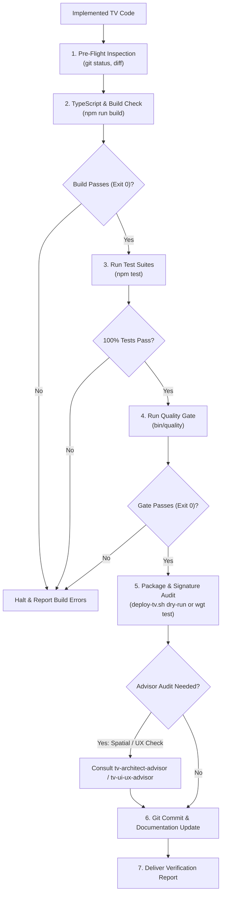

# Sonzra TV Verification Skill (`tv-verify-implementation`)

The `tv-verify-implementation` skill owns the **entire verification, testing, quality gating, and packaging validation lifecycle** after feature implementation in `sonzra-tizen`.

> [!IMPORTANT]
> **Calling Contract & Failure Policy:**
> - **Zero Tolerance:** No commit or release completion occurs until all gates pass with 100% green status.
> - **Fail Fast:** If any gate fails (TypeScript errors, test failures, focus traps), produce structured diagnostics and halt for remediation.

---

## 1. Execution Workflow



---

## 2. Verification Procedure

### Step 1: Pre-Flight Audit
Inspect modified files:
```bash
git status
git diff --stat
```

### Step 2: Build & Type Check
Verify zero TypeScript compilation errors and clean asset generation:
```bash
npm run build
```

### Step 3: Run Vitest Suites
Ensure all spatial navigation and unit tests pass:
```bash
npm test
```

### Step 4: Quality Gate
Run canonical project quality gate:
```bash
bin/quality
```

### Step 5: Cross-Project Parity Audit (sonzra-tizen -> sonzra)
Before committing any TV feature, audio buffering fix, or API integration in `sonzra-tizen`:
1. **Assess Sister Impact**: Determine if this fix, audio streaming detail, or backend endpoint requirement affects the main `sonzra` server or web app.
2. **File Issue if Applicable**: If a sister backend issue, schema gap, or web player fix is needed, file an issue on `sonzra/sonzra` using `gh`:
   ```bash
   gh issue create -R sonzra/sonzra \
     --title "[Parity] <Description of TV requirement or bugfix>" \
     --body "..."
   ```

### Step 6: Git Commit
Commit with a conventional commit message:
```bash
git add -A
git commit -m "feat(tv): <description of changes>"
```
