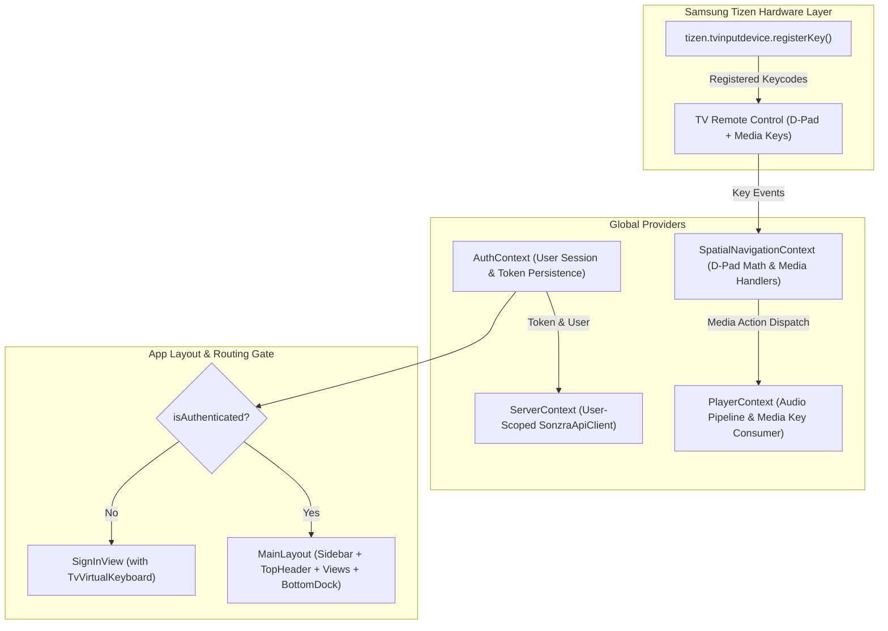

# Technical Plan: TV Remote Navigation Hardening & User Sign-In with On-Screen Keyboard

## 1. Problem Frame & Motivation

During recent physical testing on Samsung Smart TVs, two critical gaps were identified:
1. **Compromised TV Remote Navigation Experience:** Users were unable to reach multiple sections and navigation options on the screen using remote control D-pad arrows. Furthermore, physical TV remote media control buttons (Play, Pause, PlayPause, Prev, Next, Stop) did not reliably control playback from anywhere in the app.
2. **Missing User Authentication & Sign-In Entry Screen:** Sonzra is a personal, user-scoped audiophile media system, but the TV client lacked an initial sign-in page. The app must present a dedicated 10-foot Sign-In view on initial launch so Sonzra knows which user is accessing the system, scope all library and playback APIs to that authenticated user, and provide an on-screen TV virtual keyboard so entering email and password with a TV remote is effortless and ergonomic.

---

## 2. Goals & Success Criteria

### Core Goals
- **100% Remote D-Pad Reachability:** Every interactive section, sidebar rail item, header control, content shelf, dock button, and form element must be reachable via remote control arrows (Up, Down, Left, Right) with zero focus traps.
- **Physical Media Controls:** All Samsung TV remote hardware media keys (`MediaPlay`, `MediaPause`, `MediaPlayPause`, `MediaTrackNext`, `MediaTrackPrevious`, `MediaStop`, `Rewind`, `FastForward`) must be registered on startup and control audio playback globally regardless of active view or focused element.
- **Mandatory Initial Sign-In Flow:** If no valid session token exists, the app boots directly to `<SignInView />` without rendering the main navigation sidebar or player dock.
- **User-Scoped API Requests:** Authenticate against Sonzra's `POST /api/v1/session` using email and password, receive the API token and user payload, persist it in local storage, and attach `Authorization: Bearer <token>` to all subsequent requests.
- **10-Foot On-Screen Virtual Keyboard (`TvVirtualKeyboard`):** Ergonomic on-screen keyboard with D-pad navigation, caps/symbols toggles, quick email domain helpers (`@gmail.com`, `.com`), and password masking.

### Acceptance Criteria
1. D-pad navigation test matrix in Vitest passes 100% across all screens, views, and keyboard components.
2. Physical media keys trigger play/pause/skip events in `PlayerContext`.
3. Unauthenticated state displays only the `<SignInView />`; submitting valid credentials transitions seamlessly to `<HomeView />`.
4. Sign out action in Settings/Sidebar clears credentials and returns to `<SignInView />`.
5. `bin/quality` (`npm run build` and `npm test`) exits 0 with zero TypeScript errors.

---

## 3. High-Level Technical Design

### Component Architecture & State Flow

---

## 4. Implementation Units

### U1. Navigation Engine & TV Remote Key Event Hardening
**Goal:** Expand keycode and key event normalization to support all Samsung Tizen remote variants and eliminate unreachable element gaps.
- **Files to Modify:**
  - `src/navigation/tizenKeys.ts`
  - `src/navigation/SpatialNavigationContext.tsx`
  - `src/navigation/spatialMath.ts`
  - `src/components/Sidebar.tsx`
  - `src/components/TopHeader.tsx`
- **Key Technical Decisions:**
  - Support both `e.keyCode` and `e.key` (e.g. `'ArrowUp'`, `'ArrowDown'`, `'ArrowLeft'`, `'ArrowRight'`, `'MediaPlay'`, `'MediaPause'`).
  - Add missing `<Focusable>` components to the Sidebar's brand glyph (`sidebar-brand`) and user profile avatar (`sidebar-profile`).
  - Add explicit directional links where necessary between the top header area and primary page content.
- **Directional Navigation Rules:**
  - `sidebar-brand`: Down -> `sidebar-home`, Right -> main content entry point.
  - `sidebar-profile`: Up -> `sidebar-settings`, Right -> bottom dock or main content.
- **Verification:** Unit tests in `spatialMath.test.ts` verifying reachability of brand, profile, and all sidebar items.

### U2. Physical TV Media Control Buttons Integration & OSD Feedback
**Goal:** Guarantee that hardware media keys from Samsung TV remotes control playback from any screen, with an on-screen display (OSD) feedback flash.
- **Files to Modify:**
  - `src/navigation/tizenKeys.ts`
  - `src/navigation/SpatialNavigationContext.tsx`
  - `src/context/PlayerContext.tsx`
  - `src/components/MediaOsdToast.tsx` (new)
- **Key Technical Decisions:**
  - Register all media keys defensively in `registerTizenKeys()`.
  - Wire media actions (`play`, `pause`, `playpause`, `next`, `prev`, `stop`) directly in `PlayerContext`.
  - Render a lightweight ambient OSD pill (`MediaOsdToast`) in the top-right corner whenever a media key is pressed (showing play/pause/track skip icon and title for 1.5s).
- **Verification:** Vitest tests verifying media key handlers respond to synthetic `KeyboardEvent`s for `MediaPlay`, `MediaPause`, `MediaPlayPause`, `MediaTrackNext`, and `MediaTrackPrevious`.

### U3. Auth State Management & User-Scoped API Client Boundary
**Goal:** Establish user authentication state, token storage, and user-scoped API communication with the Rails server.
- **Files to Create / Modify:**
  - `src/types/auth.ts` (new)
  - `src/context/AuthContext.tsx` (new)
  - `src/services/storage.ts`
  - `src/services/sonzraApi.ts`
  - `src/context/ServerContext.tsx`
- **Key Technical Decisions:**
  - Add `User` interface (`id`, `email_address`, `name`).
  - Add `AuthContext` with methods: `signIn(email, password, serverUrl?)`, `signOut()`, `user`, `token`, `isAuthenticated`, `loading`.
  - Call Sonzra's `POST /api/v1/session` with `{ email_address, password }`.
  - Store token and user details in `localStorage` under `sonzra_auth_session`.
  - Pass `Authorization: Bearer <token>` in `SonzraApiClient` on all API requests.
- **Verification:** Unit tests in `src/services/__tests__/auth.test.ts` mocking the session endpoint.

### U4. 10-Foot On-Screen TV Virtual Keyboard Component (`TvVirtualKeyboard`)
**Goal:** Deliver a tactile, remote-friendly on-screen virtual keyboard for Smart TV text entry.
- **Files to Create:**
  - `src/components/TvVirtualKeyboard.tsx` (new)
  - `src/components/__tests__/TvVirtualKeyboard.test.ts` (new)
- **Key Technical Decisions:**
  - Layout: 4-row keyboard grid containing alphanumeric characters, spacebar, backspace, clear, caps lock/shift toggle, and domain shortcut chips (`@gmail.com`, `@`, `.com`).
  - 10-Foot ergonomics: Standard D-pad navigation across keys, with radiant cyan halos (`ring-2 ring-secondary`) and large hit-boxes ($\ge 48\text{px}\times 48\text{px}$).
  - Hardware Enter key triggers character insertion; Back key or Backspace button deletes characters.
  - Native Input Mirroring: Keep a hidden or styled `<input>` synchronized for remotes with voice dictation or Samsung Smart Control IME.
- **Directional Navigation Rules:**
  - Arrow keys step cleanly through rows and columns.
  - Moving Down from the bottom row steps to the Action buttons (Submit / Cancel).
- **Verification:** Vitest test suite testing arrow movement between keys, character typing, backspace, and submit.

### U5. Initial Sign-In View (`SignInView`) & App Authentication Gate
**Goal:** Create the standalone Sign-In view as the primary landing page for unauthenticated users.
- **Files to Create / Modify:**
  - `src/views/SignInView.tsx` (new)
  - `src/App.tsx`
  - `src/navigation/SpatialNavigationContext.tsx`
  - `src/views/SettingsView.tsx` (add Sign Out button)
- **Key Technical Decisions:**
  - When `!isAuthenticated`, `App.tsx` renders exclusively `<SignInView />` (suppressing `<Sidebar />` and `<BottomDock />`).
  - UI Layout: 12-column split screen:
    - Left (5 cols): Sonzra Audiophile branding, logo glyph, server status indicator.
    - Right (7 cols): Email and Password input slots with active field selector, followed by the integrated `<TvVirtualKeyboard />`, and "Sign In" CTA.
  - "Demo Mode" quick-entry button for instant access without a live server.
- **Directional Navigation Rules:**
  - Up/Down switches between Email input, Password input, Server URL input, and Virtual Keyboard.
  - From Keyboard, pressing Down steps to "Sign In" and "Enter Demo Mode" buttons.
- **Verification:** End-to-end routing test: initial boot renders Sign-In; successful authentication switches to Home view.

---

## 5. UI/UX & Architectural Invariants Compliance

### TV Architect Advisor Invariants
- **Zero Focus Traps:** Component tree enforces strict hierarchical boundaries. Keyboard grid has deterministic edge boundaries.
- **Decoupled Boundary:** REST client in `sonzraApi.ts` consumes `/api/v1/session` cleanly; no backend logic leaks into the TV client.
- **Defensive Hardware Key Bindings:** Guard all `window.tizen` calls with defensive checks to ensure headless Vitest execution.

### TV UI/UX Advisor Invariants
- **Dark OLED Sanctuary:** Canvas `#09090F`, form containers `#131319`, high-contrast text `#E2E1E6`.
- **Radiant Cyan Halo:** Every key on the virtual keyboard and form input features `ring-2 ring-secondary` (`#43D7C6`), `shadow-[0_0_24px_rgba(73,220,202,0.55)]`, and `scale-105` on focus.
- **10-Foot Distance Legibility:** Input fields and keyboard glyphs $\ge 18\text{px}$; button titles $\ge 16\text{px}$; high-contrast hints.

---

## 6. Verification & Quality Gates

1. **Automated Testing Suite:**
   - Expand `src/navigation/__tests__/spatialMath.test.ts` to test `SignInView` and `TvVirtualKeyboard` 2D navigation matrices.
   - Add unit tests for `AuthContext` and `SonzraApiClient` session handling.
2. **Quality Gate:**
   - Execute `bin/quality` (`npm run build` + `npm test`) and achieve exit code 0.
3. **Cross-Project Parity Gate:**
   - Verify that `/api/v1/session` matches Rails server schema on `sonzra/sonzra`.
