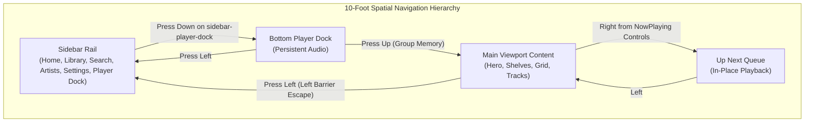

# Plan: TV UX Ergonomics, Scroll Clearance, Queue Selection, and Profile Styling

```yaml
artifact_contract: ce-unified-plan/v1
product_contract_source: ce-plan-bootstrap
execution: code
plan_depth: standard
created_at: 2026-11-12
```

## Goal Capsule

- **Objective:** Eliminate five major navigation and visual friction points on the Sonzra Tizen Smart TV app: fast access to the bottom player dock, safe queue track navigation and non-destructive track selection, unclamped list scrolling with dock safe-area clearance, reliable viewport restoration to the dashboard top telemetry, and an audiophile OLED redesign of the User Profile and Settings view.
- **Means:** Implement dedicated sidebar-to-dock spatial shortcuts and global media remote bindings, non-destructive queue index playback in `NowPlayingView`, dynamic scroll container boundary calculations with generous bottom clearance, top-row viewport resets in `SpatialNavigationContext`, and a full OLED Dark Sanctuary redesign of `SettingsView`.
- **Primary Constraints:**
  - Strict adherence to 10-foot spatial navigation invariants: zero focus traps, left barrier escape to sidebar, group memory.
  - Hardware accelerated single-surface 90ms GPU focus halos (`translateZ(0)`).
  - Continuous persistent audio streaming without interruption during view switching or settings changes.
  - Quality gate: `bin/quality` (TypeScript + Vitest unit + Playwright E2E) exit code 0.

---

## Product Contract

### Problem Frame
1. **Player Access:** On screens with dozens of items (such as Album tracklists or Library grids), reaching the bottom player dock requires 15–20 sequential D-pad Down presses.
2. **Queue Navigation & Traps:** In `NowPlayingView`, moving right from transport controls triggers the scrub bar, accidentally seeking the currently playing song; when users finally select an upcoming track, the existing queue is discarded and replaced with only that single track.
3. **Scroll Capping:** Long lists stop scrolling before reaching their end elements, causing bottom tracks and grid rows to be partially hidden or unreachable.
4. **Dashboard Header Clipping:** After scrolling down on the Home dashboard, scrolling back up anchors focus on button elements without scrolling the viewport to the very top, hiding the telemetry status and header.
5. **Settings & Profile Visual Debt:** `SettingsView` is visually disconnected from the Sonzra design system, using legacy styling, generic inputs, and browser `prompt()` dialogs.

### Requirements
- **R1 - Fast Player Dock Access:** Users must be able to reach the player dock within 1–2 remote keypresses from any view via the `<Sidebar />` rail (a dedicated Player Dock anchor at the bottom of the rail) and via global remote media keys.
- **R2 - Queue Navigation & Non-Destructive Selection:** Moving right from transport controls in `NowPlayingView` must transition cleanly into the "Up Next" queue without triggering the scrub bar; selecting a queue item must play that track in-place within the existing queue without clearing upcoming items.
- **R3 - Uncapped Viewport Scrolling:** Long lists in `AlbumDetailView`, `LibraryView`, and `ArtistsView` must scroll freely to the end, ensuring every track and card has full visibility above the persistent player dock.
- **R4 - Top-of-View Header Restoration:** Ascending to the top-most interactive row of any view (e.g. `hero-resume` in Home, category tabs in Library) must smoothly reset container `scrollTop` to 0 so page headers and status telemetry are fully visible.
- **R5 - Audiophile Profile & Settings Redesign:** `SettingsView` must be redesigned to conform to the Sonzra OLED Dark Sanctuary system: audiophile user profile card, Tizen audio engine telemetry, styled server connection controls with TV Virtual Keyboard integration, remote mapping guide, and glowing sign-out button.

### Scope Boundaries
- **In Scope:**
  - Updating `Sidebar.tsx`, `BottomDock.tsx`, `spatialMath.ts`, and `SpatialNavigationContext.tsx` for fast dock access and scroll reset.
  - Updating `NowPlayingView.tsx` and `PlayerContext.tsx` for non-destructive queue selection and scrub-bar navigation guards.
  - Layout adjustments in `App.tsx` and scroll bounding box logic in `SpatialNavigationContext.tsx`.
  - Complete component overhaul of `SettingsView.tsx`.
  - Spatial navigation unit tests (`src/navigation/__tests__/`) and Playwright E2E flows (`e2e/`).
- **Deferred to Follow-Up Work:**
  - Multi-zone synchronized audio grouping (AirPlay / RAAT streaming).
  - Editing server connection credentials across multiple users.

---

## Planning Contract

### Key Technical Decisions (KTDs)

- **KTD 1: Sidebar Rail Fast Dock Connector:** Add a persistent "Now Playing" anchor at the bottom of the `<Sidebar />` rail (`sidebar-player-dock`). Moving `Down` from the last item in the sidebar transitions focus directly to `dock-btn-play`. Moving `Left` from `dock-track-info` transitions back to `sidebar-player-dock`.
- **KTD 2: Non-Destructive Queue Selection:** In `NowPlayingView.tsx`, update track click/enter to call `playTracks(queue, targetIndex)` instead of `playTrack(track)`. In `spatialMath.ts`, map `direction === 'right'` from `np-ctrl-repeat` and `np-ctrl-fav` directly into `np-queue-${track.id}`. In `np-scrub-bar`, only intercept Left/Right when scrub mode is explicitly toggled by pressing Enter, allowing ordinary directional arrows to move across the layout.
- **KTD 3: Dynamic Container Relative Viewport Scrolling:** In `SpatialNavigationContext.tsx`, measure `rect` relative to the actual `#tv-main-scroll-container` rather than `window`. Set container bottom padding to `pb-60` (240px) to provide ample safe space above the 96px dock. Replace `behavior: 'smooth'` with instant scroll during rapid remote navigation to prevent in-flight coordinate desynchronization.
- **KTD 4: Top-Row Viewport Reset:** In `SpatialNavigationContext.setFocus()`, detect when the newly focused node belongs to the top-most group of the active view (`hero-actions`, `library-tabs`, `album-actions`, `now-playing-header`). If `container.scrollTop > 0`, reset `container.scrollTop = 0`.
- **KTD 5: OLED SettingsView Architecture:** Replace generic HTML inputs with `<Focusable />` cards, integrate with the existing `TvVirtualKeyboard` for text entry, and display live user and Tizen diagnostic telemetry.

### High-Level Technical Design



---

## Implementation Units

### U1. Fast Player Dock Navigation & Remote Shortcut
- **Files:**
  - `src/components/Sidebar.tsx`
  - `src/navigation/spatialMath.ts`
  - `src/navigation/SpatialNavigationContext.tsx`
  - `src/navigation/__tests__/playerDockNavigation.test.ts`
- **Technical Design:**
  - Add `sidebar-player-dock` as the bottom-most item in the `<Sidebar />` rail. When clicked or entered, it focuses `dock-btn-play`.
  - In `spatialMath.ts`:
    - `currentGroup === 'sidebar' && direction === 'down'`: from `sidebar-settings` move to `sidebar-player-dock`; from `sidebar-player-dock` move to `dock-btn-play`.
    - `currentGroup === 'bottom-dock' && direction === 'left'`: from `dock-track-info` move to `sidebar-player-dock`.
  - In `SpatialNavigationContext.tsx`, register global key handler for `MediaPlayPause` (key code `10252`) and remote green key (`404`) to immediately focus or toggle playback on `dock-btn-play`.
- **Test Scenarios:**
  - Moving down from the last sidebar item enters `sidebar-player-dock` and then `dock-btn-play`.
  - Moving left from `dock-track-info` enters `sidebar-player-dock`.
  - Left barrier escape from any content row allows reaching `BottomDock` via Left -> Down in 2 steps.

### U2. Queue Navigation & In-Place Selection (`NowPlayingView`)
- **Files:**
  - `src/views/NowPlayingView.tsx`
  - `src/navigation/spatialMath.ts`
  - `src/navigation/__tests__/nowPlayingQueue.test.ts`
- **Technical Design:**
  - In `src/views/NowPlayingView.tsx`:
    - Update `upcomingTracks.map(track)`: on Enter/Click, calculate `const targetIdx = queue.findIndex(t => t.id === track.id)`. Call `playTracks(queue, targetIdx)` instead of `playTrack(track)`.
    - Modify `np-scrub-bar`: Add a boolean state `isScrubbing`. Pressing `Enter` toggles scrubbing on/off. When `isScrubbing` is false, `ArrowRight` and `ArrowLeft` are NOT intercepted, allowing natural spatial navigation to move focus without accidentally altering song position.
  - In `src/navigation/spatialMath.ts`:
    - For `activeView === 'now-playing'`:
      - `currentGroup === 'now-playing-controls' && direction === 'right'`: from `np-ctrl-repeat`, `np-ctrl-fav`, or `np-ctrl-next`, transition directly to the first visible item in `now-playing-queue`.
      - `currentGroup === 'now-playing-queue' && direction === 'left'`: transition to `np-ctrl-play` or the last active control button.
- **Test Scenarios:**
  - Moving right from `np-ctrl-fav` focuses the first item in the queue.
  - Selecting track 3 in the queue begins playing track 3 while preserving track 4, 5, 6 in the queue.
  - Pressing Right while focusing the scrub bar (when not actively scrubbing) navigates focus to the right instead of seeking.

### U3. Main Viewport Scroll Capping & Overscan Clearance
- **Files:**
  - `src/App.tsx`
  - `src/navigation/SpatialNavigationContext.tsx`
  - `src/views/AlbumDetailView.tsx`
  - `src/views/LibraryView.tsx`
- **Technical Design:**
  - In `src/App.tsx`:
    - Remove `h-full min-h-full` from `<main className="...">`.
    - Set `#tv-main-scroll-container` padding: `pl-24 pt-20 px-10 pb-64`. Set `scrollPaddingBottom: '180px'`.
  - In `src/navigation/SpatialNavigationContext.tsx`:
    - Measure visibility against the scroll container's actual visible bounding rect:
      ```typescript
      const container = document.getElementById('tv-main-scroll-container');
      if (container) {
        const cRect = container.getBoundingClientRect();
        const nRect = nextNode.element.getBoundingClientRect();
        const isVisibleVertically = nRect.top >= (cRect.top + 70) && nRect.bottom <= (cRect.bottom - 140);
        if (!isVisibleVertically) {
          nextNode.element.scrollIntoView({ block: 'nearest', inline: 'nearest' });
        }
      }
      ```
    - Remove `behavior: 'smooth'` from D-pad spatial moves to eliminate laggy coordinate desynchronization.
- **Test Scenarios:**
  - In an album with 15+ tracks, the 15th track is fully visible above the player dock and selectable with focus halo intact.
  - In LibraryView with multiple rows of albums, the bottom row is completely visible and selectable.

### U4. Dashboard Top Header Scroll Restoration
- **Files:**
  - `src/navigation/SpatialNavigationContext.tsx`
  - `src/views/HomeView.tsx`
  - `src/navigation/__tests__/headerScrollReset.test.ts`
- **Technical Design:**
  - In `SpatialNavigationContext.tsx`:
    - Define top-anchor nodes per view:
      - `home`: `hero-resume`, `hero-queue`, `hero-details`, `hero-favorite`
      - `library`: `library-tab-albums`, `library-tab-artists`, `library-tab-tracks`, `library-tab-playlists`, `library-tab-podcasts`
      - `album-detail`: `album-btn-play`, `album-btn-shuffle`, `album-btn-queue`, `album-btn-fav`
    - When `setFocus(id)` is called on a top-anchor node:
      ```typescript
      const container = document.getElementById('tv-main-scroll-container');
      if (container && container.scrollTop > 0) {
        container.scrollTo({ top: 0, behavior: 'instant' });
      }
      ```
- **Test Scenarios:**
  - Navigating down to `recent-shelf` scrolls the viewport down.
  - Navigating back up to `hero-resume` immediately resets container `scrollTop` to 0, making the top telemetry bar fully visible.

### U5. Audiophile User Profile & Settings Screen Redesign
- **Files:**
  - `src/views/SettingsView.tsx`
  - `src/components/TvVirtualKeyboard.tsx`
  - `src/views/__tests__/SettingsView.test.tsx`
- **Technical Design:**
  - Transform `SettingsView.tsx` into a two-column 10-foot OLED Sanctuary dashboard:
    - **Header:** Eyebrow `SYSTEM SETTINGS`, title `Audiophile Configuration & Diagnostics`, bit-perfect DAC status pill.
    - **Left Column (Server & Network Connection):**
      - Sonzra Host URL input: Focusable field opening the on-screen `TvVirtualKeyboard` for editing URL without browser prompts.
      - Server Connection ID & Token state indicator.
      - "Test Connection" button with real-time ping latency badge (`X ms`).
      - "Save Configuration & Sync Library" button.
    - **Right Column (Active Profile & Tizen Telemetry):**
      - User Account Card: User avatar circle, email address, session scope badge (`User-Scoped Server API`).
      - Tizen Environment Card: Screen resolution (1920x1080 FHD), Tizen OS detected status, GPU acceleration active (`translateZ(0)`), bit-perfect DAC status.
      - Remote Legend: Visual key badges for D-pad, Enter, Back, Play/Pause.
      - Sign Out Button: Styled red glow action button (`bg-error/20 text-error border border-error/30`).
- **Test Scenarios:**
  - `SettingsView` renders with 10-foot OLED styles, user profile details, and zero unstyled classes.
  - Server URL field opens on-screen keyboard and updates config cleanly.
  - Test connection triggers latency check and updates the status pill.
  - Sign out invokes auth context `signOut`.

---

## Verification Contract

### Automated Quality Gate
- `npm run build` (TypeScript check and Vite build)
- `npm test` (All Vitest spatial navigation and unit suites)
- `npx playwright test` (E2E navigation, scroll bounds, and profile verification)
- `bin/quality` (Unified CI quality gate exit code 0)

### Physical Hardware Verification
- Run `./deploy-tv.sh` to package, sign, and install `Sonzra.wgt` onto the Samsung TV (`TQ65QN80FAUXXC`).
- Validate on the physical remote:
  - 2-click player dock access via Sidebar.
  - Scrolling to the bottom of long tracklists without clipping.
  - Scrolling up to Home view revealing the top header.
  - Selecting upcoming queue tracks in `NowPlayingView`.
  - Viewing the redesigned Settings & Profile view.

---

## Definition of Done
1. All 5 Implementation Units (U1–U5) completed and integrated.
2. Zero focus traps across all views, queues, and player dock transitions.
3. Vitest unit tests and Playwright E2E suites passing with 100% pass rate.
4. `bin/quality` passes with exit code 0.
5. Deployed, launched, and verified on the physical Samsung Smart TV.
